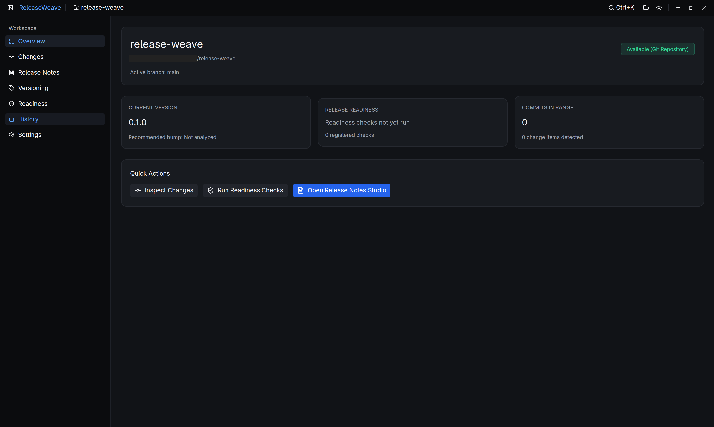

# ReleaseWeave

[](LICENSE)
[](https://www.rust-lang.org)
[]()

**ReleaseWeave** is a native desktop toolkit built in Rust for modern software release engineering. ReleaseWeave unites deterministic Git analysis, Semantic Versioning (SemVer 2.0) recommendations, multi-stage release readiness gates, verified hallucination-free local AI release notes synthesis (via Ollama), remote publishing to GitHub/GitLab, and full monorepo workspace support.

Built with **GPUI Kit** (Zero-WebView, GPU-accelerated) with pure domain decoupling (domain types and services maintain zero visual framework dependencies).



---

## Key Features

### 1. Git Analysis & Conventional Commits
- **Flexible Range Scanning:** Calculates commit ranges via SemVer tags or commit hashes.
- **Conventional Grouping:** Automatically categorizes commits (`feat`, `fix`, `docs`, `refactor`, `perf`, `test`, `chore`).
- **Breaking Change Detection:** Recognizes exclamation marks (`feat!:`) and `BREAKING CHANGE:` footer sections.
- **Safe Diff Inspection:** Renders file change patches with syntax additions/deletions and safety byte-truncation limits to avoid freezing memory.

### 2. SemVer 2.0 Versioning Engine
- **Automated SemVer Recommendations:** Calculates appropriate bumps (Major, Minor, Patch, None) based on commit history in the release range.
- **Zero-Version Awareness:** Strictly adheres to SemVer `0.y.z` specifications (breaking changes in `0.x` produce a Minor bump instead of Major).
- **Manifest Version Detection:** Reads active versions from Git tags and manifest files (`Cargo.toml`, `package.json`, `pyproject.toml`).
- **Prerelease Incrementing:** Supports prerelease workflows (`1.0.0-rc.1` -> `1.0.0-rc.2`).

### 3. Release Readiness Gates
- **Multi-Stage Verification:**
  - `working_tree_clean`: Verifies there are no uncommitted modifications or untracked artifacts.
  - `version_consistency`: Checks alignment between Git tags and project manifest declarations.
  - `changelog_updated`: Verifies `CHANGELOG.md` presence and target version staging.
  - `command_policy`: Executes automated test, lint, or build commands with timeout protections and strict shell injection rejection.
- **Accessible Status Indicators:** Every status (`Passed`, `Failed`, `Warning`, `Skipped`, `NotRun`) provides unique symbols and textual labels (NFR-A11Y-02), distinguishable without relying on color alone.

### 4. Release Notes Studio & Verified Local AI
- **Local AI Synthesis:** Connects directly to local Ollama instances (`http://localhost:11434`, default `qwen2.5-coder:7b`).
- **Hallucination Prevention (Provenance Tracking):** Every bullet generated by AI must provide a verifiable source commit hash. Fabricated hashes are marked `unsourced` and flagged with low confidence scores.
- **Deterministic Fallback:** If Ollama is unavailable or returns invalid data, a deterministic Keep a Changelog template activates instantly without losing Git analysis data.
- **Prompt Injection Isolation:** Commit messages are wrapped in secure delimiters `<<<COMMITS_START>>>` and `<<<COMMITS_END>>>` with automatic escaping.
- **Side-by-Side Editor & Live Preview:** Markdown text editor and live preview rendered natively without webviews or browser engines.

### 5. Multi-Platform Remote Publishing (GitHub & GitLab)
- **Direct Draft Releases:** Publish finalized release notes directly to GitHub Releases or GitLab Releases.
- **Secure OS Keychain:** API tokens are stored in the operating system credential manager (macOS Keychain, Linux Secret Service, Windows Credential Manager) and never stored in SQLite or plaintext.
- **Full Secret Redaction:** Automated redaction strips GitHub tokens (`ghp_***`), GitLab tokens (`glpat-***`), Bearer tokens, and private keys from logs and UI output.

### 6. Command Palette (`Ctrl+K` / `Cmd+K`)
- **Quick Keyboard Actions:** Fuzzy search navigation tabs, repository switching, package selection, readiness gate execution, theme toggling, and release finalization.
- **Adaptive Keybindings:** Detects platform conventions (`Cmd+K` on macOS, `Ctrl+K` on Linux and Windows).

### 7. Monorepo Workspace Support
- **Automatic Workspace Detection:** Supports Cargo workspaces (`[workspace] members` in `Cargo.toml`), pnpm workspaces (`pnpm-workspace.yaml`), and npm/yarn workspaces (`workspaces` in `package.json`).
- **Path-Filtered Commit Ranges:** Filters commits and diffs strictly to the package directory boundary.
- **Per-Package Tagging:** Formats tags using `name@1.2.3` or `name-v1.2.3` conventions with independent SemVer calculation.
- **Package Switcher:** Instant package selector dropdown in the navbar and command palette.

### 8. Audit Trail & Pristine Repository Guarantee
- **Local-First SQLite Database:** Persists project settings, releases (`Draft` / `Final`), and audit logs locally.
- **Comprehensive Reports:** Exports release summaries in Markdown and JSON formats with explicit disclosures of unavailable metadata.
- **Pristine Repository Guarantee:** ReleaseWeave never modifies Git repositories without explicit user instruction. By default, it creates no commits, never pushes to remote repositories, and only creates local annotated tags on HEAD when `allow_git_tag` is enabled per project.

---

## Keyboard Shortcuts

ReleaseWeave provides complete keyboard navigation:
- `Ctrl+1` / `Cmd+1`: **Overview** Tab
- `Ctrl+2` / `Cmd+2`: **Changes** Tab (Git Analysis & Diff Inspection)
- `Ctrl+3` / `Cmd+3`: **Release Notes** Tab (Studio Editor & Live Preview)
- `Ctrl+4` / `Cmd+4`: **Versioning** Tab (SemVer Recommendations)
- `Ctrl+5` / `Cmd+5`: **Readiness** Tab (Readiness Checks)
- `Ctrl+6` / `Cmd+6`: **History** Tab (Release History & Audit Logs)
- `Ctrl+7` / `Cmd+7`: **Settings** Tab (Model, Commands, Remote Tokens, & Theme)
- `Ctrl+K` / `Cmd+K`: **Command Palette**
- `Escape`: Closes modals and dialogs safely

---

## Installation & Binary Downloads

Pre-built binaries are available on the GitHub **Releases** page for Linux, macOS, and Windows:

### 1. Linux (AppImage & Tarball)
```bash
# Download AppImage and grant execution permission
chmod +x ReleaseWeave-x86_64.AppImage
./ReleaseWeave-x86_64.AppImage

# Or extract the release tarball:
tar -xzvf release-weave-linux-x86_64.tar.gz
./release-weave
```

### 2. macOS (Universal: Apple Silicon & Intel)
* Download `ReleaseWeave-macos-universal.dmg` (or `.zip`).
* Open DMG and drag `ReleaseWeave.app` into the `Applications` folder.
* **Bypassing Gatekeeper (Unsigned Community Build)**:
  * Right-click `ReleaseWeave.app` in Finder, choose **Open**, and click **Open** on the macOS confirmation dialog.
  * Or execute via terminal: `xattr -cr /Applications/ReleaseWeave.app`

### 3. Windows (x86_64)
* Download `release-weave-windows-x86_64.zip`.
* Extract the archive to your preferred directory.
* Launch `release-weave.exe`.
* **Bypassing Windows SmartScreen**:
  * If the "Windows protected your PC" prompt appears, click **More info**, then click **Run anyway**.

### 4. SHA-256 Checksum Verification
Every release includes a `SHA256SUMS.txt` manifest:
```bash
sha256sum -c SHA256SUMS.txt
```

---

## Building from Source (Development)

### Prerequisites
- [Rust Toolchain](https://rustup.rs/) (latest stable, 2024 edition).
- [Git](https://git-scm.com/) (version 2.30+).
- [Ollama](https://ollama.com/) (optional, for local AI release notes generation).

### Build & Run

```bash
# 1. Clone repository
git clone https://github.com/masyoudi/release-weave.git
cd release-weave

# 2. Run desktop application
cargo run

# 3. Execute test suite
cargo test
```

### Running Local AI Models (Ollama)

```bash
# Ensure Ollama daemon is running
ollama serve

# Download model optimized for ReleaseWeave
ollama pull qwen2.5-coder:7b
```

---

## Technical Documentation

- [Demo & Visual Walkthrough](docs/demo-walkthrough.md): Interface guide, workflows, and visual walkthrough.
- [System Architecture](docs/architecture.md): Architectural layers, SQLite schema, and async background executor.
- [Security Model](docs/security.md): Path validation, command policy, secret redaction, and prompt injection mitigation.
- [AI Models & Licensing Guide](docs/ai-models.md): Ollama configuration, JSON schema, and open-weight licensing separation.
- [Privacy Policy](docs/privacy.md): 100% local processing and read-only repository commitments.
- [Test Report & Verification](docs/testing.md): Test suite coverage, pipeline verification, and accessibility compliance.
---

## License

Distributed under the **Apache License 2.0**. See [LICENSE](LICENSE) for details.
Local AI models accessed via Ollama maintain their own independent licensing terms (see [docs/ai-models.md](docs/ai-models.md)).
