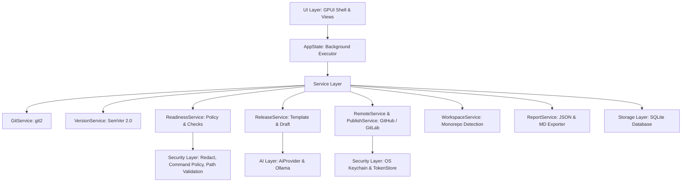

# ReleaseWeave Architecture

ReleaseWeave is designed with a layered architecture that strictly separates pure domain logic from visual presentation (GPUI Kit).

---

## 1. Architectural Layers

### A. Domain Layer (`src/domain/`)
Pure data types without external dependencies beyond Serde:
- `Project`: Project configuration and settings.
- `Package`: Workspace package metadata and relative path mappings.
- `CommitInfo`, `FileChange`: Git commits and file modification records.
- `Release`, `ChangeItem`, `SourceRef`: Release drafts and categorized change items.
- `CheckResult`, `CheckStatus`: Readiness gate outcomes and blocking policies.
- `Origin`: Item provenance tracking (Deterministic, AI-generated, External).

### B. Security Layer (`src/security/`)
- `path_validation`: Prevents path traversal vulnerabilities by validating directory and file destinations.
- `command_policy`: Enforces strict command execution policies, banning shell interpreters (`sh`, `bash`, `cmd`, `powershell`).
- `exec_resolve`: Resolves binaries securely via `PATH` and `PATHEXT` on Windows without delegating to `cmd.exe`.
- `redact`: Redacts secrets (API tokens, GitHub tokens, GitLab tokens, Bearer tokens, private keys) from logs and views.
- `secrets`: Manages OS keychain integrations (macOS Keychain, Linux Secret Service, Windows Credential Manager) via `TokenStore`.

### C. Storage Layer (`src/storage/`)
- Local SQLite database (`release-weave.db`) with idempotent schema migrations (Schema v2).
- Repositories: `ProjectRepo`, `PackageRepo`, `ReleaseRepo`, `ReadinessRepo`, `SettingsRepo`.
- Complete isolation: Git repositories are never mutated during database operations.

### D. Service Layer (`src/services/`)
- `git_service`: Git history revwalk, patch diffing, breaking change detection, conventional commit parsing, path-filtered monorepo queries, and tag creation.
- `version_service`: SemVer 2.0 analysis, manifest reading, automated bump recommendations, prerelease versioning, and package tag formatting.
- `workspace_service`: Detects monorepo workspace members across Cargo, pnpm, and npm/yarn configurations.
- `readiness_service`: Working tree cleanliness, changelog verification, version consistency, project stack auto-detection, and readiness checks.
- `publish`: Multi-platform release publishing for GitHub and GitLab APIs.
- `remote_service`: Origin URL parsing for SSH, HTTPS, and self-hosted instances.
- `template`: Deterministic template engine supporting `{{version}}`, `{{date}}`, `{{previous_version}}`, and category sections.
- `release_service`: Release notes synthesis (deterministic and local AI), category regeneration, and Markdown export.
- `report_service`: Generates comprehensive release audit reports with explicit disclosures of unavailable data.

### E. AI Layer (`src/ai/`)
- `provider`: `AiProvider` trait and `FakeProvider` for deterministic testing.
- `ollama`: Local HTTP client for the Ollama API (`/api/chat` with structured JSON mode).
- `prompts`: Context isolation using secure delimiters `<<<COMMITS_START>>>` and `<<<COMMITS_END>>>`.
- `schemas`: Structured model response validation and commit hash provenance tracking.

### F. UI Layer (`src/ui/`)
- Built with `gpui-kit` and native GPU acceleration (Zero-WebView).
- `AppState`: Manages global state and offloads background tasks via `cx.background_executor()`.
- `ShellView`: Main application shell featuring tab navigation (`Ctrl+1` through `Ctrl+7`), repository switcher, monorepo package selector, Command Palette (`Ctrl+K` / `Cmd+K`), light/dark theme toggles, and notification banners.
- Views: `OverviewView`, `ChangesView`, `ReleaseNotesView`, `VersioningView`, `ReadinessView`, `HistoryView`, `SettingsView`, and `CommandPaletteView`.
